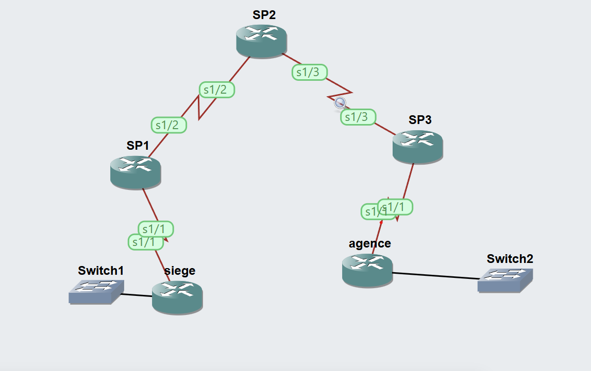

# TP 2 : Configuration d'un VPN MPLS (L3VPN)

Atelier Technologies WAN, RSI3. Simulation réalisée sous GNS3 (serveur GNS3 VM dans VirtualBox).

## Objectif

Mettre en place un VPN MPLS de niveau 3 pour un client unique (**Client A**) qui relie deux sites, **SIEGE** et **AGENCE**, à travers un backbone opérateur MPLS. Le TP couvre :

- la création d'une instance **VRF** sur les routeurs PE ;
- l'échange des routes clients avec les CE via **EIGRP** dans la VRF ;
- le transport des routes entre PE avec **MP-BGP (VPNv4)** ;
- la **redistribution** BGP ↔ EIGRP ;
- l'observation des **labels MPLS** (label stacking) dans Wireshark et avec `traceroute`.

Ce TP s'appuie sur le TP 1 (backbone MPLS : OSPF Area 0 + LDP).

## Topologie



Plan d'adressage :

| Lien | Réseau |
|---|---|
| SP1 - SIEGE | 192.168.12.0/24 |
| SP1 - SP2 | 192.168.23.0/24 |
| SP2 - SP3 | 192.168.34.0/24 |
| SP3 - AGENCE | 192.168.45.0/24 |
| LAN SIEGE | 10.10.10.0/24 |
| LAN AGENCE | 192.168.1.0/24 |

Loopbacks : SP1 `1.1.1.1/25`, SP2 `2.2.2.2/25`, SP3 `3.3.3.3/25`.

## Paramètres du VPN

| Paramètre | Valeur |
|---|---|
| Nom de la VRF | `Client_A` |
| RD (Route Distinguisher) | `100:1` |
| RT (Route Target) | `1:100` (import et export, mot-clé `both`) |
| AS de l'opérateur (EIGRP et BGP) | `1` |
| AS EIGRP du client | `100` |
| Voisins BGP VPNv4 | SP1 (1.1.1.1) et SP3 (3.3.3.3), via Loopback0 |

## Déroulement

1. **Étape 1 : VRF.** Création de `Client_A` sur SP1 et SP3, association à l'interface `Serial1/1` côté CE, puis ressaisie de l'adresse IP (supprimée à l'activation de la VRF). Les pings sans `vrf` échouent depuis le PE, ceux avec `vrf Client_A` réussissent.
2. **Étape 2 : EIGRP dans la VRF.** Démarrage d'EIGRP AS 1 sur les PE, avec `address-family ipv4 vrf Client_A` et `autonomous-system 100`. Les PE n'ont aucune route client dans leur table globale ; elles sont dans la table VRF.
3. **Étape 3 : BGP VPNv4 et redistribution.** Session iBGP entre les loopbacks de SP1 et SP3, activation de la famille `vpnv4` avec `send-community both`, puis redistribution mutuelle BGP ↔ EIGRP dans la VRF.
4. **Étape 4 : tests.** Pings entre sites, capture Wireshark sur la liaison SP2-SP3 et traceroutes pour observer les labels.

## Réponse à la question du TP

> Si SP1 reçoit une route VPNv4 avec la Route Target 100:100, BGP l'importe-t-il dans la VRF ?

**Non.** La VRF `Client_A` n'importe que la RT `1:100` (`route-target both 1:100`). Une route portant la RT `100:100` ne correspond à aucune RT d'import et n'est pas insérée dans la table VRF.

## Résultats observés

- **Backbone :** voisinages LDP en état `Oper` sur SP1 et SP3 (voisin SP2), loopbacks joignables via OSPF, pings `3.3.3.3 source 1.1.1.1` et `1.1.1.1 source 3.3.3.3` réussis.
- **Étape 3 :** les routeurs SP1 et SP3 ont des routes **B** (BGP) vers les réseaux du site opposé dans la VRF.
- **SIEGE** apprend par EIGRP (D) `192.168.45.0/24` et `192.168.1.0/24` via `192.168.12.1` (SP1).
- **AGENCE** apprend par EIGRP (D) `192.168.12.0/24` et `10.10.10.0/24` via `192.168.45.1` (SP3).
- **Étape 4 :** voir les captures dans `captures/` et `screenshots/` (pings, trames MPLS avec deux labels, traceroutes).

## Label stacking

Dans le backbone, chaque paquet client porte deux labels :

- **Label externe (transport, LDP)** : change à chaque saut ; c'est le seul que le routeur P (SP2) examine.
- **Label interne (VPN, BGP VPNv4)** : annoncé par le PE de sortie, il reste inchangé de bout en bout et identifie la VRF de destination (bit Bottom of Stack = 1).

Le routeur P ne possède aucune route du Client A.

## Structure du dépôt

```
tp-mpls-vpn/
├── README.md          Ce fichier
├── commandes.md       Toutes les commandes du TP, étape par étape
├── configs/           Configurations des routeurs (show running-config)
├── captures/          Captures Wireshark (.pcap) de la liaison SP2-SP3
├── screenshots/       Captures d'écran (tables de routage, Wireshark, traceroutes)
└── gns3/              Fichier de projet GNS3 (.gns3)
```

## Vidéo de démonstration

Enregistrement complet du TP (ActivePresenter, export MP4, environ 57 minutes) : _ajouter ici le lien Drive ou YouTube (non répertorié)_.

## Environnement

- GNS3 (interface web) sur GNS3 VM, VirtualBox
- Wireshark sous Windows 11
- Routeurs Cisco IOS émulés
